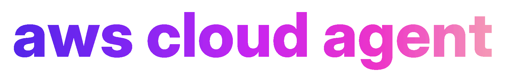
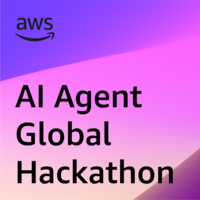
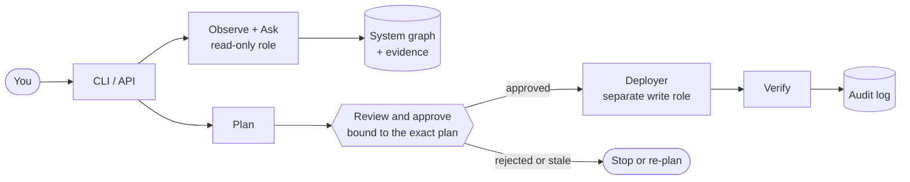

<p align="center">
  
</p>

<p align="center">
  <b>Understand, question and safely evolve the AWS applications you already run.</b><br>
  Evidence-backed answers · Read-only first · Approval-gated changes
</p>

<p align="center">
  <a href="https://github.com/Alejo2075/aws-cloud-agent/actions/workflows/ci.yml"></a>
  <a href="https://github.com/Alejo2075/aws-cloud-agent/releases"></a>
  <a href="LICENSE"></a>
  
  
</p>

<p align="center">
  <a href="#what-it-does">What it does</a> ·
  <a href="#how-it-works">How it works</a> ·
  <a href="#quick-start">Quick start</a> ·
  <a href="#security-by-design">Security</a> ·
  <a href="#known-limitations">Limitations</a> ·
  <a href="ROADMAP.md">Roadmap</a>
</p>

<br>

<p align="center">
  <a href="https://aws-agent-hackathon.devpost.com/">
    
  </a>
</p>

<p align="center">
  <b>This project is part of the</b><br>
  <a href="https://aws-agent-hackathon.devpost.com/"><b>AWS AI Agent Global Hackathon</b></a>
</p>

<br>

Cloud Agent is an open-source TypeScript agent for **existing** AWS applications. It discovers what is deployed, builds a source-attributed system graph, answers questions with cited observations, and can propose, validate and, only after explicit approval, apply changes. It is not a greenfield app generator and not an unrestricted AWS admin tool: reads and writes are separated in code, roles and CLI.

> [!WARNING]
> **v0.4.0 prerelease.** Everything is implemented and tested against fixtures, mocked AWS SDK clients and local CDK synthesis. **It has not been run against a real AWS account or real Bedrock yet.** See [Known limitations](#known-limitations).

## What it does

### 🔎 Understand

- **Observe** — scoped, read-only discovery of CloudFormation stacks, tagged resources and explicit ARNs: Lambda, API Gateway (HTTP and REST), DynamoDB, SQS, SNS, S3, EventBridge, Step Functions, Kinesis, ECS services and RDS instances. Every relationship carries provenance (`discovery` vs `inferred`).
- **Ask** — Bedrock-backed Q&A over read-only tools. Citations are validated against real tool output; unverifiable ones are removed and the answer says so.
- **Operate (read)** — bounded CloudWatch metrics, Lambda log search, deployment history, cost by tag, repository and IaC inspection. Log text and cost data need explicit per-connection consent.

### 🛠️ Change, with approval

- **Plan** — model-proposed plans with a derived risk class and an immutable hash. Nothing is applied.
- **Approve and apply** — approvals are bound to plan hash, source revision, environment, account, region, actor and expiry. Drift or a moved revision invalidates them. Apply is idempotent, through a CloudFormation change-set deployer or a new `cloud-agent/<change-id>` git branch in an isolated worktree (push and PR only on request).
- **Validate and verify** — local worker or ephemeral CodeBuild for isolated builds; `metric` and `http` criteria are checked automatically and fail closed; everything lands in a hash-chained audit log.

### 🧩 Extend and host

- **Plugins** — hash-pinned read-only tools, in-process or in a permission-restricted process with `--isolated` (Node 25+).
- **Import** — `CloudSystemManifest` v1 ([JSON Schema](docs/integration/cloud-system-manifest.schema.json)) as a hint, reconciled against live discovery.
- **Hosted state** — DynamoDB and S3 stores plus a CDK stack in `infra/` ([details](docs/hosted-deployment.md)); an HTTP API with authentication, per-system authorization and rate limiting in `apps/api`.

## How it works



## Security by design

- **Read-only first.** Discovery and Q&A use a read-only role and ports that only list, describe and get. The only writers are the deployers.
- **Approval is bound by hash** to the exact plan, target and actor; stale plans cannot be applied.
- **Telemetry, repositories and tool output are untrusted data**, wrapped and redacted before reaching a model.
- **Consent-gated data.** Log contents and cost data are off by default.
- **No credentials stored.** Roles are assumed per run.

Details: [security model](docs/security-model.md).

## Requirements

- Node.js 22+ and pnpm 9
- For real use: an IAM **read-only role** you create (see [security model](docs/security-model.md)), and a Bedrock model or inference profile enabled in your account.

## Install and develop

```bash
git clone https://github.com/Alejo2075/aws-cloud-agent.git
cd aws-cloud-agent
pnpm install
pnpm check        # typecheck, lint, format, tests
```

Run the CLI from source:

```bash
pnpm --filter @cloud-agent/cli start -- --help
```

## Quick start

```bash
# 1. Register a scoped read-only connection and run discovery
cloud-agent connect --stack restaurant-app-prod --region us-east-1 \
  --role-arn arn:aws:iam::123456789012:role/CloudAgentReadOnly \
  --system restaurant-app --repo ../restaurant-app

# 2. Inspect and ask
cloud-agent systems inspect restaurant-app
export CLOUD_AGENT_MODEL_ID=<your Bedrock model or inference profile id>
cloud-agent ask --system restaurant-app "How does a reservation flow through this application?"

# 3. Propose a change (read-only), then review it
cloud-agent plan --system restaurant-app --template cdk.out/app.template.json --stack app "Set the checkout timeout to 20 seconds"
cloud-agent changes show <change-id> --system restaurant-app
cloud-agent changes validate <change-id> --system restaurant-app --check "pnpm test"
cloud-agent changes approve <change-id> --system restaurant-app
cloud-agent changes apply <change-id> --system restaurant-app --template cdk.out/app.template.json
cloud-agent changes verify <change-id> --system restaurant-app --confirm v1
cloud-agent audit
```

State lives in `~/.cloud-agent` (override with `CLOUD_AGENT_HOME`). Credentials are never stored; roles are assumed per run.

## Packages

Packages under `packages/` (plus `apps/cli`, `apps/api` and `infra/`): `contracts` (Zod schemas), `connections` (scope), `tools-aws` (read-only ports and SDK adapters), `discovery`, `graph`, `evidence` (redaction, store, audit), `manifest`, `tools-git`, `agent` (tools, ask, planner), `changes` (plans, policy, state machine), `validation`, `deployments`, `stores-aws`; CLI in `apps/cli`. Details: [architecture](docs/architecture.md), [security model](docs/security-model.md), [change lifecycle](docs/change-lifecycle.md).

## Testing

`pnpm test` runs unit and integration tests with in-memory fakes, `aws-sdk-client-mock`, temp git repositories and scripted models. No test contacts AWS.

## Known limitations

- **Not verified live.** No run against a real account, Bedrock, CodeBuild or CloudFormation. Expect integration bugs.
- Resource coverage: see the Observe row above. REST APIs have no metrics yet (CloudWatch keys them by API name, which the graph does not carry). X-Ray, ECS clusters, RDS clusters and other types are listed without configuration or edges, and the graph reports this as a gap.
- Drift detection covers topology and the stable configuration summary of supported resources. The health gate checks CloudFormation stack status and firing CloudWatch alarms that reference in-scope resources; if alarm status cannot be verified the apply is blocked unless you pass `--ignore-alarms`, which is audited. There are no SLO objects.
- The local validation worker is a convenience, not a sandbox; use CodeBuild for isolation.
- A plan deploys either a CloudFormation template you supply (bound to the approved plan by sha256) or its patches on a new branch. Hand-edited or already-modified branches are never touched. There is no Terraform `apply`.
- `apps/api` and the stores and CDK stack are code only: no API Lambda wiring, identity provider integration or retention jobs, and nothing has been deployed. See [hosted deployment](docs/hosted-deployment.md) and the [ROADMAP](ROADMAP.md).
- Isolated plugins need Node 25+ and fail closed on older versions.

## Contributing

See [CONTRIBUTING.md](CONTRIBUTING.md) and [SECURITY.md](SECURITY.md). The product specification and engineering rules are in [CLAUDE.md](CLAUDE.md).

## License

Apache-2.0. See [LICENSE](LICENSE).
